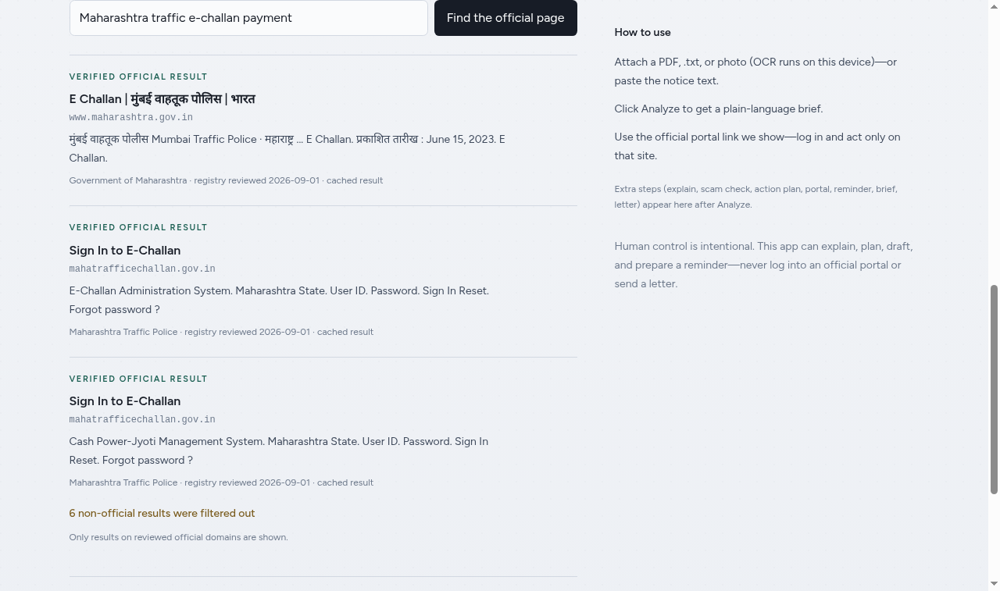

# Nagrik Saathi

Nagrik Saathi is a Safe Public-Document Copilot: it explains notices,
extracts dates and amounts, builds a checklist, and points people to reviewed
official channels without acting on government portals.

## Run locally

```bash
pnpm install
pnpm dev
```

Open `http://localhost:3000`. Paste or upload a real notice, then click
**Analyze**. Nothing is preloaded.

## Test and build

```bash
pnpm lint
pnpm test
pnpm build
pnpm start
```

## Deploy

Local verify only for now (`pnpm lint`, `pnpm test`, `pnpm build`, browser).
There is intentionally **no GitHub Actions CI**. Optional HTTPS deploy notes live
in [docs/DEPLOY.md](docs/DEPLOY.md).

## Goals

Iteration goals and loop prompts: [docs/GOAL_AND_LOOP.md](docs/GOAL_AND_LOOP.md).
Living status: [docs/STATUS.md](docs/STATUS.md).

## WebMCP

The home page registers eight top-level tools through
`document.modelContext`. Native WebMCP is preferred; the MCP-B polyfill makes
local inspection possible when the browser has no native implementation.
Chrome local testing uses `chrome://flags/#enable-webmcp-testing` and the
Model Context Tool Inspector. ChatGPT Site tools require its desktop built-in
browser and an eligible model/account rollout.

## Live official-portal discovery (SerpApi)

Nagrik Saathi normally answers from a static, reviewed registry of official
government portals. Live discovery adds current search results on top of
that registry — without weakening the project's rule that only a reviewed
official source is ever presented as official.



How it works:

1. The user asks for a document or service.
2. The app calls `GET /api/discover?q=<query>`, which queries SerpApi
   (Google engine, India location) server-side. The API key is read from
   the `SERPAPI_API_KEY` environment variable and is never committed.
3. Every result is filtered against the verified portal registry: a result
   is shown only if its hostname matches a reviewed portal's verified
   domain or allowed hostnames. Everything else is counted and dropped —
   never shown as a link.
4. Responses are cached per query for 10 minutes, so repeated questions
   do not burn search credits.

Error behaviour, plainly:

- Invalid query → `400`
- `SERPAPI_API_KEY` not configured → `503` ("Live discovery is not
  configured on this server.")
- SerpApi request fails → `502`, with a fallback message pointing to the
  reviewed portal directory
- No live result matches a reviewed portal → the app says so plainly and
  points the user to the printed helpline or the department office,
  instead of guessing a link.

Setup: copy `.env.example` to `.env` and set `SERPAPI_API_KEY` to a key
from a free SerpApi account, then run `pnpm install` and `pnpm dev`.

Public deployments (BYOK): the server key is optional. A deployment can
run with no `SERPAPI_API_KEY` at all — visitors who want live discovery
paste their own free SerpApi key into the field above the search box.
The key is stored only in their browser and sent per request; the
operator carries no key and cannot be charged for anyone's searches.

Built for the SerpApi India Hackathon 2026 as a feature on top of the
pre-existing Nagrik Saathi project.

## Safety

This app does not collect credentials, OTPs, Aadhaar, PAN, or banking details.
It does not make payments, file grievances, submit forms, send letters, or
automate official sites. Read [docs/SAFETY.md](docs/SAFETY.md) before adding
features.
