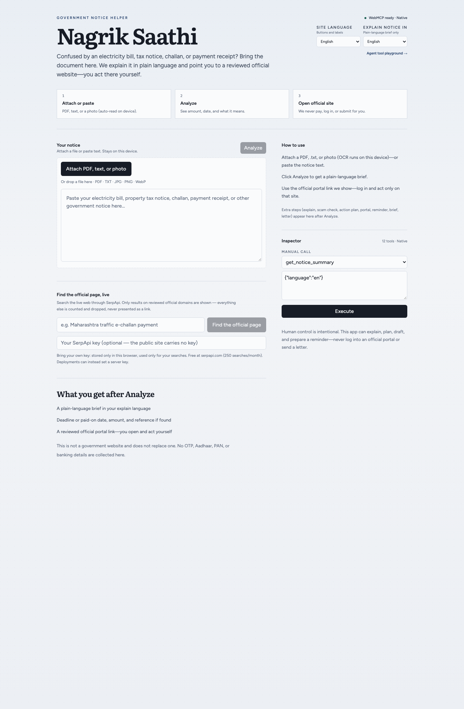

# Stage 1 close-out — native WebMCP

**Date:** 2026-10-26  
**Browser:** Google Chrome 154.0.8037.93, headless, `--enable-features=WebMCP`  
**Build:** local production build (`pnpm build`, then `pnpm exec next start -p 3001`)

## Why the flag

Chrome 154 still ships WebMCP behind the testing flag / origin trial. No
origin-trial token was requested for this run. The flag enables the same native
`document.modelContext` implementation locally. Production visitors need a
token until the feature ships broadly (Chrome 157 per Chrome Status). The
MCP-B polyfill remains the fallback for browsers without the native API.

## Inspector result

- Mode: **Native** (not polyfill, not local fallback)
- Surface: **12 tools**
- The inspector lists the shared registry, including the two approval-gated
  browser-only tools.

## Native execution

All twelve tools were called through the page's native
`document.modelContext.executeTool` from the main world. The test harness used
Chrome DevTools Protocol; it did not call the local tool objects directly.

| Tool | Observed result |
| --- | --- |
| `analyze_notice` | `status: analyzed`, `electricity_bill`, MSEDCL, ₹2,430, deadline `2026-09-02` |
| `get_notice_summary` | Marathi summary, 4 actions, 2 documents |
| `check_scam_signals` | `risk: no_obvious_signals` |
| `create_action_plan` | `status: ready`, 2 documents |
| `draft_citizen_letter` | `status: draft_only` |
| `translate_brief` | `status: localized`, Hindi summary |
| `generate_checklist_document` | `status: ready`, 3,144-character print-ready HTML |
| `find_official_portal` | `verified: true`, MSEDCL portal, helpline `1912 / 1800-233-3435` |
| `verify_portal_url` | `verified: true`, `match: registered_path` |
| `redact_pii` | `status: redacted`, 2 redactions |
| `schedule_reminder` | approval modal shown, `status: success`, next-day `DTEND` |
| `export_family_brief` | approval modal shown, `status: success`, redacted brief |

The two side-effect tools were approved once each through the visible approval
dialog. Deny was not exercised in this native run; it is covered by unit tests
and earlier browser evidence.

## Limits

- Native mode was enabled by a Chrome flag, not an origin-trial token.
- The run is headless and scripted; no human recording was made.
- ChatGPT Site tools were not run (no eligible account).
- The MCP server parity is recorded separately under Stage 2.
